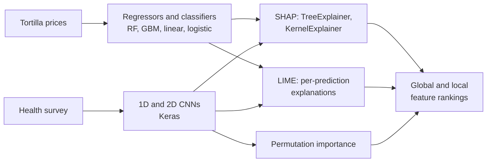

# Explainable AI with SHAP and LIME, and What Explanations Can't Tell You

**SHAP and LIME applied to four models on two datasets: tortilla prices in Mexico (regression and classification) and a health survey (a CNN on tabular data). The most useful result is that a model can be explained in detail and still be no better than guessing.**

[](https://colab.research.google.com/github/dojedaro/explainable-ai-shap-lime/blob/main/tortilla_prices_shap_lime.ipynb)
[](https://colab.research.google.com/github/dojedaro/explainable-ai-shap-lime/blob/main/health_survey_cnn_shap.ipynb)
[](https://github.com/dojedaro/explainable-ai-shap-lime/actions/workflows/notebooks.yml)

## Results

### 1. Tortilla prices: test scores that cross-validation doesn't back up

Price per kilogram from state, city, store type, year, month, quarter and day of week (a random 10%
sample of 28,982 rows).

| Regressor | Test R² | Test RMSE | 5-fold CV R² |
|---|---|---|---|
| Linear regression | 0.830 | 1.91 | 0.54 ± 0.09 |
| Random forest | **0.989** | **0.49** | 0.53 ± 0.26 |
| Gradient boosting | 0.949 | 1.04 | 0.46 ± 0.35 |

| Classifier (store type) | Test accuracy | 5-fold CV accuracy |
|---|---|---|
| Random forest | **0.996** | 0.84 ± 0.09 |
| Gradient boosting | 0.961 | 0.80 ± 0.08 |
| Logistic regression | 0.952 | **0.91 ± 0.03** |

The random forest looks best on the single test split and is middling under cross-validation, with a
large spread. The two evaluations ask different questions: the test split is random, so near-identical
rows (same city, store type and month) land on both sides, while `cross_val_score(cv=5)` uses
contiguous, unshuffled folds, so each fold is a block of the file the model hasn't seen. The CV number
is closer to how the model would do on new places or periods. On classification, the simplest model
is the most reliable.

### 2. Health survey: a CNN that learned the majority class

Perceived health status (3 classes) from emotional-intelligence (TMMS) and sleep-quality (PSQI) scores.
57.6% of the 1,222 rows had missing values and were dropped, leaving 518.

| Model | Test accuracy | Recall per class (0 / 1 / 2) |
|---|---|---|
| 1D CNN on tabular features (49.9k parameters) | 0.644 | 0.95 / 0.17 / **0.00** |
| Majority-class baseline | 0.635 | 1.00 / 0.00 / 0.00 |
| 2D CNN (35.6k parameters) | 0.692 | (see notebook) |

The 1D CNN is barely above always predicting class 0 and never identifies the smallest class.
**LIME still produced clean, confident per-prediction explanations for it** (SHAP was run on a
simplified stand-in model). Explanation methods
describe what a model does; they say nothing about whether what it does is right. Check the model
against a baseline before explaining it.

## How it works



## Run it

Neither dataset is included. Save the Kaggle *Tortilla Prices in Mexico* data as `tortilla_prices.csv`
next to the first notebook; the health-survey CSV is uploaded in Colab when the second notebook asks.

```bash
pip install -r requirements.txt
jupyter notebook tortilla_prices_shap_lime.ipynb
```

## Stack

Python, SHAP, LIME, scikit-learn, XGBoost, TensorFlow/Keras, pandas, Matplotlib, seaborn.

## Limitations and next steps

- The tortilla notebook samples 10% of rows without a fixed seed, so reruns differ. Fix the seed and
  use a grouped split (by store), which tests what matters: prices for a store the model hasn't seen.
- Dropping 58% of the health data removes most of the signal; impute instead, and compare against a
  gradient-boosting baseline, which usually beats CNNs on small tabular data.
- One cell's SHAP inputs came from a cell that was later removed; the notebook explains how to
  recompute them.

*Moved into its own repository on 2026-11-13 from an older multi-project repository.*

## License

MIT
